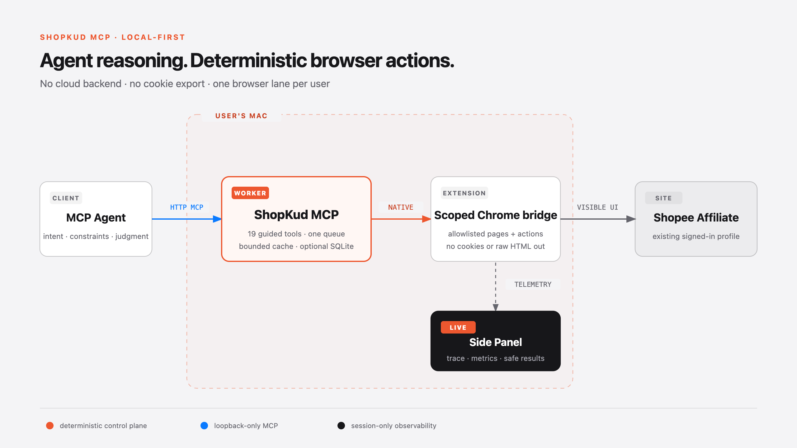

# ShopKud MCP architecture



ShopKud is a standalone local MCP server for Shopee Affiliate Thailand. It
connects an MCP-capable agent to the user's existing signed-in Chrome profile
without exporting cookies, session tokens, or page HTML to another service.

## System boundary

```text
MCP-capable agent
      |
      | Streamable HTTP + private bearer, loopback only
      v
ShopKud worker (one per OS user)
  - 19 guided tools by default
  - deterministic research/link/report workflows
  - one serialized browser lane
  - explicit, bounded result cache
  - trace and performance events
  - optional embedded SQLite file
      |
      | private Unix socket + Chrome Native Messaging
      v
ShopKud Chrome extension
  - validates the native host and command allowlist
  - reads only supported visible Shopee surfaces
  - executes bounded, explicitly requested actions
  - renders results in a full-page Dashboard
  - streams compact live telemetry to the Side Panel
  - groups extension-owned work tabs and closes them after use
      |
      v
Shopee pages in the user's existing Chrome profile
```

The MCP client can be Codex, Claude Code, Cursor, or any client that supports
Streamable HTTP MCP and private request headers. No gateway is part of the
ShopKud architecture.

## Why the worker exists

Chrome extensions cannot expose a local MCP endpoint by themselves. The small
Python worker provides the protocol boundary, owns the browser queue, validates
requests, and keeps multi-step workflows deterministic. On macOS it runs as one
per-user launchd service and uses approximately tens of MiB of RAM.

The worker is not a cloud backend. It binds to `127.0.0.1`, stores its bearer
key in a private local config, and communicates with the extension through a
private Unix socket. Multiple agents share this one worker rather than starting
one process or browser profile per agent.

## Freshness and cache correctness

Shopee prices, sales and commissions can change at any time. Therefore cached
results are never treated as current truth. The calling agent chooses the
freshness policy for each research request:

| Mode | Reuse window | Intended use |
|---|---:|---|
| `live` | 0 seconds | Default for a decision or user-visible answer |
| `recent` | 60 seconds | Immediate comparison or retry where small staleness is accepted |
| `fast` | 10 minutes | Exploration where speed matters more than current values |

`live` never reuses an earlier completed observation. Identical `live` calls
that are already running concurrently may share that same in-flight browser
observation so agents do not race one tab. Every response reports whether it
was reused, why, its observation time, and its age. The cache disappears when
the worker stops.

The optional SQLite workspace is different: it stores user-approved briefs,
link mappings, aggregate reports and history. It is an embedded file managed by
Python; it does not cache live Shopee facts and requires no database server.

## Agent judgment versus deterministic code

The agent decides the research intent and constraints:

- `commission_value`: highest displayed commission value per order
- `commission_rate`: highest displayed commission percentage
- `sales_volume`: strongest visible sales evidence
- `balanced`: normalized commission value plus log-scaled sales evidence

It may also set category, minimum sales, minimum commission, maximum price,
trust requirements and freshness. ShopKud then performs the bounded search,
page traversal, detail verification, exclusions and ranking as deterministic
code.

An empty result is a valid answer: it means no observed candidate satisfied the
chosen constraints. ShopKud returns exclusion counts and possible relaxations,
but never weakens the user's constraints silently. The agent or user decides
whether to retry with different criteria.

## Human and Agent surfaces

The Agent uses MCP for communication and decisions. The owner reads the actual
research result in the Extension Dashboard:

1. An Agent may gather external niche, trend, purchase-intent or store evidence
   with its own configured research tools.
2. `present_research_report` sends a bounded summary and HTTPS citations to the
   local Dashboard. These fields remain explicitly Agent-authored judgments.
3. `rank_affiliate_products` performs the Shopee search, filters, detail checks
   and ranking as deterministic code.
4. The Dashboard combines the two evidence classes without pretending an
   external claim came from Shopee. Product links and source citations stay
   clickable so the owner can trace the recommendation.
5. The Side Panel shows current stage, health and a safe developer log while the
   Dashboard stays optimized for non-technical review.

Extension-created Shopee tabs and the Dashboard share one Chrome Tab Group.
Inactive automation tabs close after their operation completes. If the owner
activates a work tab, ShopKud relinquishes ownership and leaves it open.

## Tool surface

New installations expose 19 guided tools in six groups:

| Group | Tool | Purpose |
|---|---|---|
| System | `get_workflow_guide` | Return the versioned affiliate playbook once per agent session |
| System | `list_pages` | Discover connected supported pages without reading arbitrary tabs |
| System | `reload_extension` | Reload an idle local unpacked build and reconnect safely |
| System | `selector_health` | Read-only check for supported page contracts |
| Research | `rank_affiliate_products` | Run bounded search, filtering, channel verification and chosen ranking goal |
| Research | `get_product_detail` | Read visible facts for one exact affiliate offer |
| Research | `search_products_for_content` | Prepare a reviewable research set without selecting products |
| Research | `get_product_media` | Return previously observed, allowlisted product media URLs |
| Research | `present_research_report` | Render cited Agent research and purchase-intent signals in the local Dashboard |
| Links | `create_link` | Create one explicitly authorized affiliate link with SubIDs |
| Links | `verify_link` | Verify saved ownership/target evidence without opening the tracking link |
| Links | `batch_create_links` | Run a sequential, checkpointed authorized link batch |
| Links | `find_link` | Find an existing registry link before creating another |
| Performance | `import_report_csv` | Preview then digest-bind an owner-supplied aggregate report import |
| Performance | `sales_by` | Aggregate imported performance by a supported dimension |
| Performance | `get_conversions` | Read mapped and unmapped aggregate conversion evidence separately |
| Performance | `get_earnings_summary` | Read the latest stored aggregate earnings snapshot |
| Missions | `list_missions` | Read mission records already tracked in the local workspace |
| Missions | `enroll_mission` | Preview or record an already-completed Shopee enrollment locally; never clicks Shopee |
The 58-tool full profile remains available for diagnostics, legacy content
drafts and custom clients. Media generation and posting are intentionally not
part of the recommended ShopKud v1 surface.
It is not the recommended agent-facing surface because it exposes primitives
that the guided workflows already compose safely.

## Trust boundaries

- The MCP endpoint is loopback-only and requires a private bearer key.
- The native host accepts only the installed extension origin.
- Browser commands and page types are allowlisted and schema-validated.
- Browser work is serialized to prevent agents from racing the same tab.
- Challenge, login, changed-page and uncertain-result states fail closed.
- Secrets, cookies, buyer identifiers and raw page HTML are not returned.
- Mutating actions remain explicit; installation checks are read-only.

## Installation model

The supported public path is native macOS installation because ShopKud must
attach to the owner's real Chrome profile. Docker would still require host
Chrome, profile access and a platform-specific Native Messaging registration,
so it adds a daemon without removing the platform work.

Give the repository URL to a coding agent and ask it to install ShopKud. The
agent should read the root [`AGENTS.md`](../AGENTS.md), then follow
[`INSTALL_FOR_AGENTS.md`](INSTALL_FOR_AGENTS.md). The human only needs to
approve/load the unpacked Chrome extension and sign in to Shopee when needed.

Verified public target: macOS, Google Chrome, Python 3.11 or newer. Linux and
Windows packaging are not claimed until their native-host and service-manager
paths have their own tests.

## Observability

Each guided workflow emits bounded stages and final metrics to the Dashboard
and Side Panel tracker:
queue wait, browser operations, cache status, latency, response size, success
and effectiveness. The token number is an output-size estimate only; MCP cannot
observe the calling model's private input, reasoning, or output token usage.

The developer Working Log is a separate session-only Side Panel stream. It shows Agent
tool calls, allowlisted/redacted argument summaries, Python/extension source
locations, function or browser-operation names, progress and completion/failure
events as they happen. Completed tool calls include a bounded summary of the
exact result returned to the Agent, including a ranked winner when present. It
deliberately cannot display a model's hidden chain of
thought or arbitrary shell work performed outside ShopKud; those facts never
enter the MCP server. The extension keeps at most 500 sanitized log lines in
Chrome session storage and offers explicit follow/pause and clear controls.
