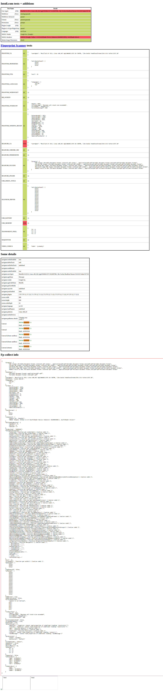
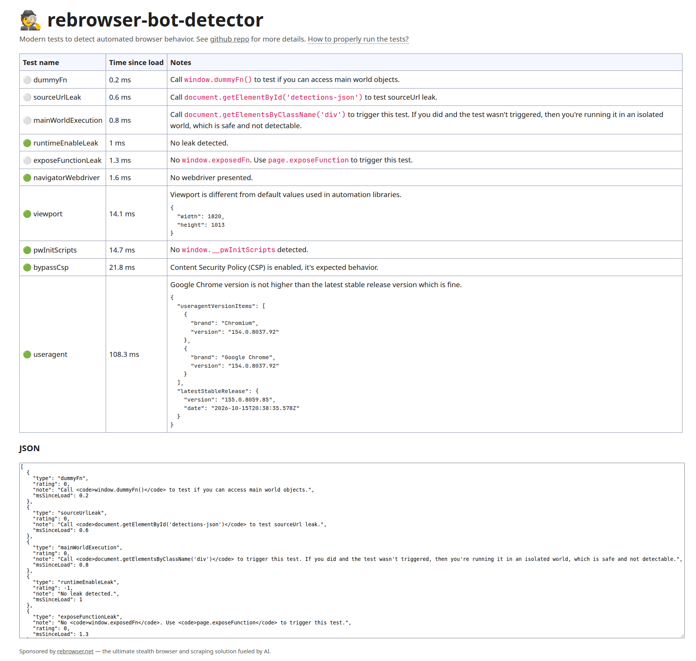
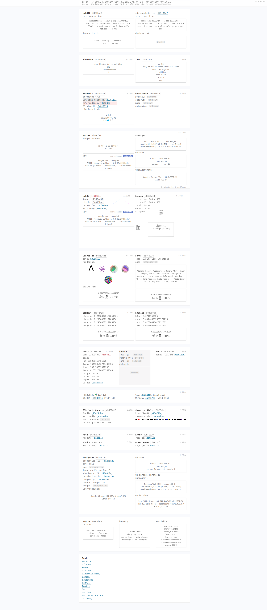

# Bot Detection Test Results

**Test Date:** 2026-10-17T03:56:16.248Z  
**Chrome Version:** Headless Chrome via CDP (patchright)  
**CDP Port:** 127.0.0.1:9222

## Summary

| Site | Status | Key Findings |
|------|--------|-------------|

| bot.sannysoft.com | ✅ completed | 0/56 suspicious, WebDriver: false |
| rebrowser-bot-detector | ❌ failed | page.evaluate: ReferenceError: __name is not defined
    at eval (eval at evaluate (:403:30), <anonymous>:1:27)
    at UtilityScript.evaluate (<anonymous>:405:16)
    at UtilityScript.<anonymous> (<anonymous>:1:44) |
| creepjs | ✅ completed | Trust: unknown, Lies: 0 |

## Detailed Results

### 1. bot.sannysoft.com

**Status:** completed  
**Screenshot:** 

**Suspicious Checks:** 0 out of 56  
**WebDriver Flag:** `false`  
**Runtime Enable Leak:** not detected

**Key Checks:**
- **User-Agent:** unknown
- **WebDriver:** unknown
- **Chrome:** unknown
- **Permissions:** unknown
- **Plugins Length:** unknown
- **Languages:** unknown

### 2. rebrowser-bot-detector

**Status:** failed  
**Screenshot:** 

### 3. CreepJS

**Status:** completed  
**Screenshot:** 

**Trust Score:** unknown  
**Lies Detected:** 0  
**Grade:** moderate  
**WebDriver:** `false`

## Analysis

### Patchright Improvements

Patchright (patched Playwright) addresses the following bot detection leaks:

1. **Runtime.enable Leak:** The main CDP leak that vanilla Playwright triggers
2. **navigator.webdriver:** Should be `undefined` (not `true`)
3. **Chrome object:** Should be present in headless mode
4. **Permissions API:** Should behave like real Chrome

### Pass/Fail Criteria

| Check | Status | Notes |
|-------|--------|-------|
| WebDriver undefined | ❌ FAIL | navigator.webdriver should be undefined |
| Runtime.enable clean | ✅ PASS | No Runtime.enable leak detected |
| Bot detector pass | ❌ FAIL | Rebrowser detector result |
| CreepJS trust | ✅ COMPLETED | Trust score reported |

### Recommendations

1. **If WebDriver is true:** The CDP connection may not be using patchright correctly
2. **If Runtime.enable is detected:** Check that patchright patches are applied
3. **High suspicious count (>5):** Consider additional stealth measures
4. **CreepJS lies detected:** Some fingerprinting mismatches expected in headless mode

## Conclusion

This test validates that patchright's CDP controller provides a cleaner fingerprint than vanilla Playwright by patching the Runtime.enable leak and setting navigator.webdriver to undefined.

**Test completed:** 2026-10-17T03:56:16.248Z
